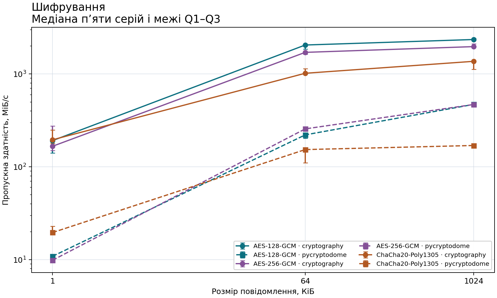
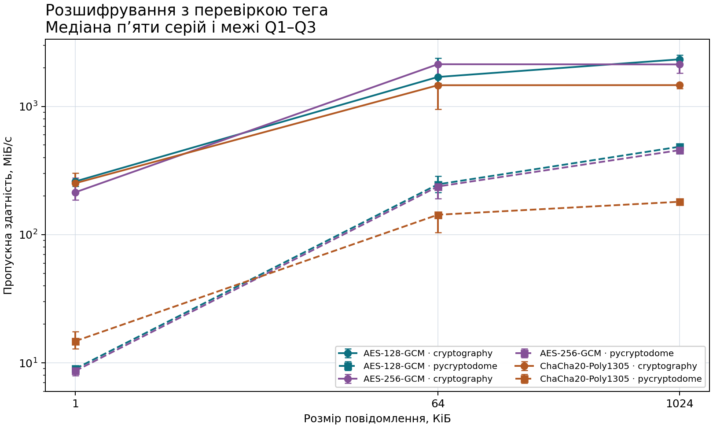

# Практична робота №2. Симетричне шифрування в API «Цифровий деканат»

**Європейський університет · факультет інформаційних систем**  
Абрамочкін Владислав Олександрович, група Б2F5  
Дисципліна «Безпека інформаційних систем»

## Мета й індивідуальний варіант

Мета роботи — додати захищені службові примітки до наявного API і виміряти шифрування та перевірене розшифрування однакових повідомлень у двох бібліотеках. Номер у списку 1 дає варіант 1 за формулою `1 % 4 = 1`. У моделі примітки додано `category` з допустимими значеннями `general`, `academic`, `administrative`. Якщо категорію пропущено, застосунок використовує `general`. Категорія зберігається у конверті, повертається в обох відповідях і входить до асоційованих даних (AAD).

Власний [форк](https://github.com/abramochkinvl-ops/digital-dean-api-starter) продовжує ПР №1 з тега `practice-01`. Гілка `practice-02` містить злиття з викладацькою `upstream/practice-02-starter`. Тег `practice-02-base` указує на коміт злиття `75b74b1`. Злиття має предками фінал ПР №1 та заготовку ПР №2.

- `df0fb18` — адаптери двох бібліотек і лічильник одноразових значень.
- `45f824e` — захищені примітки в API та автентифікація категорії.
- `aa5a0f8` — модуль вимірювань і валідований маршрут звіту.
- `ccdad33` — тести підміни, категорії, лічильника та регресії.
- `e3cc95d` — запуск вимірювань за недоступності точного імені процесора.
- Фінальний тег `practice-02` позначає коміт зі звітом, фактичними вимірами й колекцією Postman. Його хеш визначає команда `git rev-parse "refs/tags/practice-02^{}"`.

## Зміни в API

| Метод і шлях | Успіх | Оброблені помилки |
| --- | --- | --- |
| `POST /api/v1/students/{student_id}/secure-notes` | 201, повертає `id`, `student_id`, `algorithm`, `category` | 404 для невідомого студента, 422 для некоректного запиту, 503 після вичерпання лічильника |
| `GET /api/v1/students/{student_id}/secure-notes/{note_id}` | 200, повертає метадані й перевірений `text` | 404 для відсутнього ресурсу або іншого студента, 422 для неправильного UUID, 500 для пошкодженого конверта |
| `GET /api/v1/lab/crypto/benchmark-results` | 200, перевірена схема 1 і 36 рядків | 404 для відсутнього файла, 500 для некоректного або недоступного файла |

Моделі студентів, операції та фільтр `enrollment_year` з ПР №1 збережено. Маршрут звіту читає один шлях, налаштований на сервері, і перевіряє структуру JSON. Вимірювання виконуються окремою командою.

- `app/schemas/secure_note.py` перевіряє категорію й довжину тексту до 4096 байтів UTF-8. Початкові пробіли непорожнього тексту зберігаються.
- `app/security` містить адаптери `seal_bytes` і `open_bytes`, профілі, AAD, генератор ключа та лічильник. Використано AES-128-GCM, AES-256-GCM і ChaCha20-Poly1305 в обох бібліотеках. У всіх профілях nonce має 12 байтів, тег — 16.
- `app/main.py` створює 32-байтовий випадковий ключ, його ідентифікатор, лічильник та порожнє сховище при запуску. Запис приміток використовує AES-256-GCM у `cryptography`. Спільний лічильник під блокуванням резервує кожен nonce лише один раз на ключ. Навчальна межа становить 1 000 000 операцій запису на ключ.
- `app/api/secure_notes.py` перевіряє студента й передає в адаптер канонічний контекст із версією, UUID студента й примітки, алгоритмом, ідентифікатором ключа та категорією. Репозиторій зберігає конверт із шифротекстом і тегом, без тексту й ключа. Під час читання AAD відтворюється з очікуваних UUID і метаданих. Відкритий текст повертається після перевірки тега й декодування UTF-8. Пошкоджений запис дає 500 із повідомленням `Protected note unavailable`.

## Середовище й методика

| Параметр | Фактичне значення |
| --- | --- |
| Запуск | 09.11.2026 о 11:43 за Києвом |
| Ідентифікатор запуску | `ce30dc44-feb0-435b-bcb7-a53b238c8f19` |
| Фіксація коду перед дослідом | `e3cc95dbe0d01c17ea21d52df3b9a5b9b94be6b7` |
| Процесор | AMD EPYC 7763 64-Core Processor |
| ОС та архітектура | Linux-6.18.57-x86_64-with-glibc2.41, x86_64 |
| Python | 3.12.14 |
| Бібліотеки | cryptography 48.0.1, PyCryptodome 3.24.0 |
| Компонент cryptography | OpenSSL 4.0.1 9 Jun 2026 |
| Відомості про прискорення | Прапорець `aes` доступний процесу. Фактичний вибір апаратного шляху бібліотеками окремо не вимірювався. |
| Роздільність `perf_counter` | 1.0 нс |

Розміри повідомлень становили 1, 64 та 1024 КіБ. Для кожного розміру всі шість комбінацій обробляли однакові байти й однаковий 64-байтовий AAD. Кожна пара бібліотеки й профілю отримала незалежний випадковий ключ і власний лічильник. Перед вимірюванням перевірено точне відновлення байтів. Прогрівання включало 10 операцій для кожної комбінації, розміру та напряму. Далі виконано п’ять серій по 100 операцій. Порядок комбінацій перемішувався перед кожною серією з фіксованим початковим значенням 2026. Ключі генерувалися незалежно від цього перемішування.

Таймер охоплював створення об’єкта шифру, виклик адаптера і відповідну криптографічну операцію. Підготовка даних, ключів, nonce й конвертів виконувалася до таймера. Для серій розшифрування повторно використовувався один підготовлений конверт на комбінацію й розмір. Шифрування кожного повідомлення отримувало новий nonce, включно з прогріванням. HTTP, запис файлів та побудова графіків виконувалися поза вимірюваними ділянками.

## Результати вимірювань

[Сирі результати, 180 серій](../results/practice-02/raw.csv) · [Підсумковий JSON, 36 рядків](../results/practice-02/report.json).

Медіана та IQR обчислені з п’яти середніх часів серій. Квартилі обчислено методом `inclusive`. Пропускна здатність використовує розмір початкового повідомлення та медіану. Позначки на графіках відповідають медіані, відрізки — пропускній здатності, перерахованій із Q1 і Q3 часу.

### Шифрування

| Бібліотека | Профіль | КіБ | Медіана, мкс | IQR, мкс | МіБ/с |
| --- | --- | ---: | ---: | ---: | ---: |
| cryptography | AES-128-GCM | 1 | 5.089 | 1.915 | 191.91 |
| cryptography | AES-256-GCM | 1 | 5.855 | 2.965 | 166.78 |
| cryptography | ChaCha20-Poly1305 | 1 | 4.986 | 1.557 | 195.88 |
| pycryptodome | AES-128-GCM | 1 | 89.687 | 9.678 | 10.89 |
| pycryptodome | AES-256-GCM | 1 | 98.897 | 10.571 | 9.87 |
| pycryptodome | ChaCha20-Poly1305 | 1 | 49.774 | 7.930 | 19.62 |
| cryptography | AES-128-GCM | 64 | 30.420 | 3.695 | 2054.56 |
| cryptography | AES-256-GCM | 64 | 36.506 | 2.408 | 1712.05 |
| cryptography | ChaCha20-Poly1305 | 64 | 61.314 | 7.496 | 1019.34 |
| pycryptodome | AES-128-GCM | 64 | 282.646 | 35.249 | 221.12 |
| pycryptodome | AES-256-GCM | 64 | 243.565 | 13.247 | 256.61 |
| pycryptodome | ChaCha20-Poly1305 | 64 | 406.997 | 163.512 | 153.56 |
| cryptography | AES-128-GCM | 1024 | 424.677 | 15.885 | 2354.73 |
| cryptography | AES-256-GCM | 1024 | 506.467 | 34.413 | 1974.46 |
| cryptography | ChaCha20-Poly1305 | 1024 | 729.457 | 164.336 | 1370.88 |
| pycryptodome | AES-128-GCM | 1024 | 2122.976 | 53.554 | 471.04 |
| pycryptodome | AES-256-GCM | 1024 | 2127.945 | 107.203 | 469.94 |
| pycryptodome | ChaCha20-Poly1305 | 1024 | 5883.463 | 286.198 | 169.97 |

### Розшифрування з перевіркою тега

| Бібліотека | Профіль | КіБ | Медіана, мкс | IQR, мкс | МіБ/с |
| --- | --- | ---: | ---: | ---: | ---: |
| cryptography | AES-128-GCM | 1 | 3.748 | 0.369 | 260.55 |
| cryptography | AES-256-GCM | 1 | 4.555 | 1.691 | 214.41 |
| cryptography | ChaCha20-Poly1305 | 1 | 3.871 | 0.676 | 252.29 |
| pycryptodome | AES-128-GCM | 1 | 108.443 | 2.781 | 9.01 |
| pycryptodome | AES-256-GCM | 1 | 112.665 | 17.655 | 8.67 |
| pycryptodome | ChaCha20-Poly1305 | 1 | 66.009 | 20.012 | 14.79 |
| cryptography | AES-128-GCM | 64 | 36.773 | 14.751 | 1699.63 |
| cryptography | AES-256-GCM | 64 | 29.254 | 7.023 | 2136.47 |
| cryptography | ChaCha20-Poly1305 | 64 | 42.653 | 24.396 | 1465.32 |
| pycryptodome | AES-128-GCM | 64 | 252.973 | 73.364 | 247.06 |
| pycryptodome | AES-256-GCM | 64 | 262.989 | 69.226 | 237.65 |
| pycryptodome | ChaCha20-Poly1305 | 64 | 436.840 | 167.459 | 143.07 |
| cryptography | AES-128-GCM | 1024 | 428.675 | 38.236 | 2332.77 |
| cryptography | AES-256-GCM | 1024 | 469.534 | 130.702 | 2129.77 |
| cryptography | ChaCha20-Poly1305 | 1024 | 681.048 | 46.222 | 1468.32 |
| pycryptodome | AES-128-GCM | 1024 | 2059.690 | 325.932 | 485.51 |
| pycryptodome | AES-256-GCM | 1024 | 2191.429 | 120.603 | 456.32 |
| pycryptodome | ChaCha20-Poly1305 | 1024 | 5534.321 | 91.504 | 180.69 |

Для повідомлення розміром S байтів шифротекст має S байтів, а разом із тегом — S + 16. Окремо зберігаються 12-байтовий nonce та метадані конверта.

## Перевірки захисту та API

- [pytest](../results/practice-02/pytest.txt) — 163 успішні тести, включно з 51 регресійним тестом ПР №1. Для всіх шести комбінацій перевірено відновлення даних, підміну шифротексту, тега, ключа, AAD і nonce. Перевірено сумісність у двох напрямах для кожного алгоритму.
- Інтеграційні тести підтверджують відмову при перенесенні конверта до іншого студента, зміні дозволеної категорії в конверті, вичерпанні лічильника й пошкодженні конверта. Вичерпання блокує нові записи, а створені примітки залишаються доступними. Після невдалої автентифікації сервер повертає загальне повідомлення без тексту.
- [Postman-колекція ПР №2](../postman/digital-dean-practice-02.postman_collection.json) через Newman звернулася до локального Uvicorn. [Вивід Newman](../results/practice-02/newman.txt) підтверджує 14 запитів і 21 перевірку без помилок. Колекція ПР №1 також виконана на оновленому API, 24 запити та 38 перевірок без помилок.
- Повторний запуск із фінального стану описано в [README](../README.md).

## Висновки й межі

У цьому запуску cryptography мала вищу медіанну пропускну здатність, ніж PyCryptodome, для кожного зіставленого профілю, розміру та операції. Для 1024 КіБ найбільшу медіанну швидкість шифрування й перевіреного розшифрування показав AES-128-GCM у cryptography, відповідно 2354,73 та 2332,77 МіБ/с. Для шифрування 1 КіБ найбільше значення показав ChaCha20-Poly1305 у cryptography, 195,88 МіБ/с. Ці виміри залежать від середовища, реалізації та розміру повідомлення. Навчальна межа тексту API становить 4 КіБ, тому результати для 1024 КіБ описують адаптери, а час HTTP-запиту ними не вимірювався.

AES-256-GCM у cryptography відповідає профілю API й пройшов позитивні, негативні та міжбібліотечні перевірки. Тести підтверджують поведінку в заданих сценаріях. Сховище та ключ тимчасові й розраховані на один процес. Перезапуск знищує примітки й створює новий ключ. Під час локальної демонстрації використовуються синтетичні дані та HTTP. Робота не впроваджує автентифікацію користувача, авторизацію доступу або TLS.

Документація: [cryptography AEAD](https://cryptography.io/en/latest/hazmat/primitives/aead/) · [PyCryptodome AEAD](https://www.pycryptodome.org/src/cipher/modern) · [RFC 8439](https://www.rfc-editor.org/rfc/rfc8439.html) · [NIST SP 800-38D](https://csrc.nist.gov/pubs/sp/800/38/d/final).
